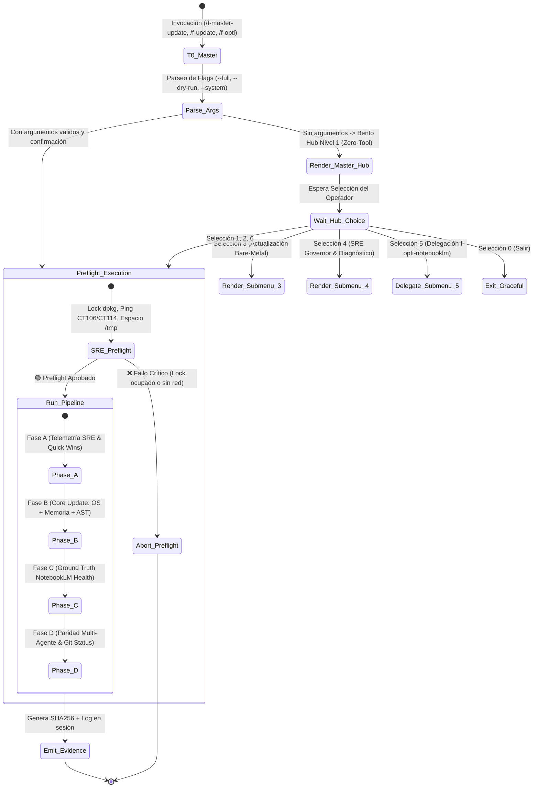

# Super Skill: Master Update & SRE Sovereign Governor (f-master-update v2.0.0)
## Arquitectura Unificada en 2 Niveles, Preflight Determinista, Aislamiento AppImage & Certificación con Evidencia (Protocolo v28.1)

> 🚨 **COMPUERTA DE INTERCEPCIÓN DURA — REGLA ZERO-TOOL TURN 0 (INQUEBRANTABLE)**:
> Al invocarse esta skill mediante cualquiera de sus triggers (`/f-master-update`, `/f-update`, `/f-opti`, `actualizar repos`, `flatpak update`, etc.):
> 1. **PROHIBIDA LA EJECUCIÓN DIRECTA O MUTACIÓN DE SISTEMA EN TURNO 0**:
>    - Queda estrictamente prohibido lanzar scripts bash, comandos APT, Flatpak, git pull o purgas en el primer turno de conversación sin autorización explícita.
> 2. **EMISIÓN OBLIGATORIA DEL MENÚ BENTO NIVEL 1**:
>    - Si el usuario no envía un atajo numérico explícito (`/f-master-update [1-6]`), el agente DEBE emitir de inmediato el Menú Bento Nivel 1 y detener su turno a la espera de la elección del operador.

---

## 🧭 1. MAQUINA DE ESTADOS Y COMPUERTA ZERO-TOOL TURN 0



---

## 🛡️ 2. TIERS DE RIESGO Y POLÍTICA DE CONSENTIMIENTO

Toda operación del sistema se clasifica en tres niveles estrictos de blast-radius:
* **`[RO]` (Read-Only)**: Diagnósticos pasivos, consultas y status. Ejecución sin confirmación adicional.
* **`[RW]` (Safe-Mutation)**: Limpieza de temporales, compactación de memoria bajo lock, compilación de grafo AST y sincronización Git fast-forward. Modo `--dry-run` por defecto; ejecución real bajo confirmación de menú.
* **`[IRR]` (Irreversible / Alto Riesgo)**: Modificación de paquetes de sistema (`apt upgrade`, purga de Flatpaks). Exige bandera explícita `--yes` y confirmación humana previa.

---

## 🎯 3. MENÚ BENTO NIVEL 1 — MASTER HUB

Al invocar `/f-master-update` o sus triggers sin flags directos, el agente emite inmediatamente este menú:

```markdown
╔═════════════════════════════════════════════════════════════════════════════════════════════════╗
║             ⚡ F-MASTER-UPDATE — MASTER SRE & SOVEREIGN UPDATE HUB v2.0.0 Enterprise             ║
║                     Ecosistema FloydIA — Protocolo v28.1 (HP15 / Mesh LXC)                      ║
╚═════════════════════════════════════════════════════════════════════════════════════════════════╝

Selecciona una acción operativa respondiendo con el NÚMERO correspondiente:

1️⃣ 🚀 **Suite Completa Soberana (Full Sovereign Sweep)** [Riesgo: RW/IRR | ETA: ~4-6 min | Fases: A | B | C | D]
   ↳ Pipeline integral de 4 Fases:
     • Fase A: Telemetría SRE, purga de procesos huérfanos y saneamiento de temporales.
     • Fase B: Actualización de sistema OS (APT/Flatpak), Memory Bank, Catálogo de Imágenes,
       reconstrucción del Grafo AST (`graphify update .`) y `CODEX_FLOYDIA.md`.
     • Fase C: Auditoría de integridad de cuadernos NotebookLM (`notebooklm_curator.py --health`).
     • Fase D: Sincronización multi-agente (`sync_skills_multiagent.sh --fix`) y auditoría Git.

2️⃣ ⚡ **Optimización Rápida & Mantenimiento Diario (Quick Wins)** [Riesgo: RW | ETA: ~45 s | Fases: A]
   ↳ Saneamiento seguro de temporales (`antigravity_speed_boost.sh --apply --clean-tmp`),
      purga de procesos parásitos, compactación rápida de memoria y verificación de paquetes
      actualizables sin reinicio.

3️⃣ 🛰️ **Submenú Especializado: Actualización Bare-Metal & Sistema** [Nivel 2 | Fases: B]
   ↳ Despliega las opciones granulares de actualización de sistema, catálogo de imágenes,
      reconstrucción de grafo AST y smoke tests (`update_floydia.py`).

4️⃣ 🔍 **Submenú Especializado: Optimización & SRE Governor** [Nivel 2 | Fases: A]
   ↳ Despliega herramientas de diagnóstico de hardware/red, análisis de cuellos de botella PSI,
      rescate anti-hang seguro y verificación de salud MCP.

5️⃣ 🧠 **Submenú Especializado: Base de Verdad NotebookLM** [Nivel 2 | Fases: C]
   ↳ Delegación directa al motor soberano `f-opti-notebooklm` y consulta de los cuadernos SSOT.

6️⃣ 🐙 **Auditoría & Sincronización Git de Repositorios Activos** [Riesgo: RW | ETA: ~30 s | Fases: D]
   ↳ Inspección de estado (`sync_git_repos.sh --status`) y sincronización remota no destructiva
      (`--ff-only`) de los repositorios del ecosistema.

0️⃣ 🚪 **Salir del Hub**
```

---

## 📂 4. SUBMENÚS ESPECIALIZADOS (NIVEL 2)

### 🛰️ Submenú 3: Actualización Bare-Metal & Sistema (`update_floydia.py`)

```markdown
╔═════════════════════════════════════════════════════════════════════════════════════════════════╗
║                   🛰️ SUBMENÚ 3: ACTUALIZACIÓN BARE-METAL & SISTEMA                              ║
╚═════════════════════════════════════════════════════════════════════════════════════════════════╝

1️⃣ **Actualización Completa (Full Pipeline Fases 0 a 6)** [IRR]
   ↳ Preflight, OS (APT/Flatpak/NPM), Antigravity Suite, Memoria, Catálogo Imágenes, Grafo AST y Smoke Tests.
      `python3 SCRIPTS/update_floydia.py --full --dry-run` (añadir `--yes` para aplicar).
2️⃣ **Catálogo Visual & Metadatos Semánticos de Imágenes** [RW] 📸
   ↳ Ejecuta `python3 SCRIPTS/update_floydia.py --images` (dimensiones, DPI, ratios, ALT text y JSON).
3️⃣ **Compactación del Memory Bank & Auditoría Syncthing** [RW]
   ↳ Ejecuta `python3 SCRIPTS/memory_compactor.py` bajo lock exclusivo, verificando budget.
4️⃣ **Auditoría de Sistema y Paquetes Upgradables (Modo Dry-Run)** [RO]
   ↳ Inspecciona actualizaciones APT/Flatpak sin aplicar cambios: `python3 SCRIPTS/update_floydia.py --system --dry-run`.
5️⃣ **Reconstrucción del Grafo AST (Graphify) & Manifiesto CODEX** [RW]
   ↳ Regenera AST determinista y CODEX: `python3 SCRIPTS/update_floydia.py --graph --codex`.
6️⃣ **Smoke Tests & Certificación Rápida del Sistema** [RO]
   ↳ Comprobación de integridad, `dpkg --audit` y latencia Graphify: `python3 SCRIPTS/update_floydia.py --verify`.
7️⃣ **Sincronización Multi-Agente (Trinidad Canónica)** [RW]
   ↳ Asegura paridad en OpenCode y DeepSeek Harness: `bash SCRIPTS/sync_skills_multiagent.sh --fix`.
0️⃣ **Volver al Menú Principal**
```

### 🔍 Submenú 4: Optimización & SRE Governor (`f-opti-floydia`)

```markdown
╔═════════════════════════════════════════════════════════════════════════════════════════════════╗
║                     🔍 SUBMENÚ 4: OPTIMIZACIÓN & SRE GOVERNOR                                   ║
╚═════════════════════════════════════════════════════════════════════════════════════════════════╝

1️⃣ **Diagnóstico Global del Ecosistema** [RO] (`ecosystem_probe.py`: CPU, RAM, ZRAM, PSI, CT114, CT106, MikroTik).
2️⃣ **Saneamiento Rápido de Temporales & Procesos Parásitos** [RW] (`antigravity_speed_boost.sh --apply --clean-tmp`).
3️⃣ **Rescate de Emergencia Anti-Hang (< 1s)** [RW] (`kill_hung_agents.sh` respetando lista blanca).
4️⃣ **Diagnóstico de Cuellos de Botella & Errores I/O** [RO] (`bottleneck_analyzer.py`: dmesg, PSI, throttling).
5️⃣ **Auditoría de Agentes & Semáforo MCP** [RO] (`healthcheck_mcps.py`: valida DSH, Antigravity, OpenCode).
6️⃣ **Auditoría de Conectividad Mesh & Latencias TCP** [RO] (CT114 :3000, CT106 :8384, DNS IA).
0️⃣ **Volver al Menú Principal**
```

### 🧠 Submenú 5: Base de Verdad NotebookLM

> **DELEGACIÓN SOBERANA**: La visualización de cuadernos y curación temática vive exclusivamente en `f-opti-notebooklm`.
> Al seleccionar esta opción, el agente invoca el skill `f-opti-notebooklm`. Para auditorías directas de salud documental, invocar:
> `python3 SCRIPTS/notebooklm_curator.py --health`

---

## 🔍 5. PREFLIGHT Y VERIFICACIÓN PREVIA

Antes de ejecutar cualquier pipeline de actualización o mantenimiento, el agente ejecuta las siguientes comprobaciones obligatorias:
1. **Cerrojos de Sistema**: Comprobar que `/var/lib/dpkg/lock-frontend` no esté tomado por otro proceso.
2. **Espacio en Disco**: Validar que `/` y `/tmp` tengan al menos 500 MB libres (`df -m /tmp`).
3. **Aislamiento AppImage**: Purgar `LD_LIBRARY_PATH` y `GIO_EXTRA_MODULES` para evitar fallos de librerías.
4. **Verificación de Red**: Comprobar conectividad básica antes de iniciar descargas (`ping -c 1 1.1.1.1` o DNS).
5. **Comprobación de Conflictos Syncthing**: Verificar que no existan archivos `.sync-conflict` en carpetas clave.

---

## 🚀 6. MATRIZ DE EJECUCION DE FASES (PIPELINE A ➔ D)

### 6.1 Fase A — SRE Telemetría & Quick Wins
- **Comandos**: `python3 FLOYDIA/PUBLIC_REPOS/floydia-skills/skills/f-opti-floydia/scripts/ecosystem_probe.py` y `bash SCRIPTS/antigravity_speed_boost.sh --apply --clean-tmp --kill-duplicates`.
- **Timeout**: 25s.
- **Aserción**: Código de salida exit 0 y reporte de telemetría emitido.

### 6.2 Fase B — Actualización Core Bare-Metal
- **Comandos**: `python3 SCRIPTS/update_floydia.py --full --dry-run` (o `--yes` si fue confirmado). Incluye paquetes OS, Flatpak con `env -u LD_LIBRARY_PATH flatpak update -y`, memoria y reconstrucción Graphify AST.
- **Timeout**: 300s.
- **Aserción**: Manifiesto `CODEX_FLOYDIA.md` generado y exit 0.

### 6.3 Fase C — Ground Truth NotebookLM Health
- **Comando**: `python3 SCRIPTS/notebooklm_curator.py --health`.
- **Timeout**: 30s.
- **Aserción**: Diagnóstico de cuadernos SSOT completado sin excepciones no controladas.

### 6.4 Fase D — Paridad Multi-Agente & Git Status
- **Comandos**: `bash SCRIPTS/sync_skills_multiagent.sh --fix` y `bash SCRIPTS/sync_git_repos.sh --status`.
- **Timeout**: 30s.
- **Aserción**: Paridad de enlaces simbólicos verificada al 100% y estado de árboles de trabajo reportado.

---

## 🚨 7. CONTINGENCIA Y RECUPERACIÓN ANTE FALLOS

* **Fallo en APT/DPKG**: Si el gestor de paquetes reporta lock ocupado o interrupción, ejecutar `sudo dpkg --configure -a` únicamente bajo autorización explícita; nunca forzar `kill -9` sobre `dpkg`.
* **Fallo en Sincronización Git**: Si un repositorio presenta cambios no confirmados (`dirty`) o divergencias remotas, omitir la sincronización automática y reportar el estado exacto; nunca invocar `git reset --hard` sin orden expresa.
* **Degradación Elegante**: Si una fase no crítica falla (ej. timeout de red en comprobación de NotebookLM), registrar el fallo como advertencia en el reporte final y permitir que las fases restantes continúen.

---

## ⏱️ 8. TIMEOUTS Y ANTI-HANG

* Todo comando con latencia de I/O o red se ejecuta con límite estricto de espera de 20s (salvo descargas masivas de paquetes en APT/Flatpak, limitadas a 300s).
* Si un comando supera su tiempo asignado, se cancela inmediatamente mediante group-kill para recuperar el control sin dejar procesos huérfanos.
* Se prohíbe el uso de comandos interactivos que soliciten contraseñas en bloqueante; utilizar siempre `sudo -n` para fail-fast inmediato.

---

## 🛡️ 9. GUARDRAILS INMUTABLES SRE (PROTOCOLO v28.1)

1. **Idioma Obligatorio**: Menús, logs, advertencias y reportes DEBEN redactarse en **español**.
2. **P0 — Anti-Fuga de Secretos**: PROHIBIDO escribir credenciales o tokens de archivos `.env` en logs o salidas terminal. Reemplazar siempre por `[REDACTED]`.
3. **P3 — Prohibición de `sync` Global**: PROHIBIDO invocar la instrucción de shell `sync` en carpetas sincronizadas con Dropbox o Syncthing para prevenir micro-bloqueos en Electron/Xorg.
4. **P4 — Lista Blanca Estricta Anti-Hang**: El rescate de procesos (`kill_hung_agents.sh`) NUNCA debe tocar Antigravity IDE, LSPs (`jedi`, `tsserver`), Syncthing, Dropbox ni demonios del sistema.
5. **P8 — Certificación con Evidencia**: Toda actualización debe registrar un artefacto verificable en `.session/` con hash SHA256 y reporte de ejecución.
6. **P9 — Aislamiento AppImage**: Purgar siempre `LD_LIBRARY_PATH` antes de invocar `flatpak` o utilidades del sistema para evitar colisiones con librerías empaquetadas.
7. **P10 — Actualización Flatpak Dual**: Actualizar runtimes a nivel de usuario y a nivel de sistema mediante invocaciones separadas y saneamiento de huérfanos.
8. **P11 — Sincronización Git No Destructiva**: Los repositorios solo admiten actualización remota mediante `git pull --ff-only` si el árbol de trabajo está estrictamente limpio (`clean`). Nunca forzar sobrescrituras.

---

## 🔄 10. IDEMPOTENCIA Y LEDGER DE SESIÓN

* Cada ejecución completa o parcial genera un registro estructurado en `.session/master_update_last_run.json` con timestamps, fases completadas y códigos de retorno.
* La re-ejecución de cualquier fase es estrictamente segura e idempotente, sin duplicar entradas ni sobrescribir archivos sin respaldo.
* Toda mutación en archivos críticos genera un respaldo previo con extensión `.bak`.

---

## 🌐 11. PARIDAD MULTI-AGENTE Y TRINIDAD CANÓNICA

| Entorno / Agente | Estado | Mecanismo de Integración |
|---|:---:|---|
| **Antigravity IDE** | 🟢 Nativo | Lectura directa en `.agents/skills/f-master-update/SKILL.md` con menú Bento interactivo |
| **OpenCode Desktop / CLI** | 🟢 Sincronizado | Symlink automático en `~/.opencode/skills/f-master-update` vía `sync_skills_multiagent.sh` |
| **DeepSeek Harness (`dsh`)** | 🟢 Sincronizado | Enlace SSOT en `~/.dsh/` y perfiles de ejecución compartidos |
