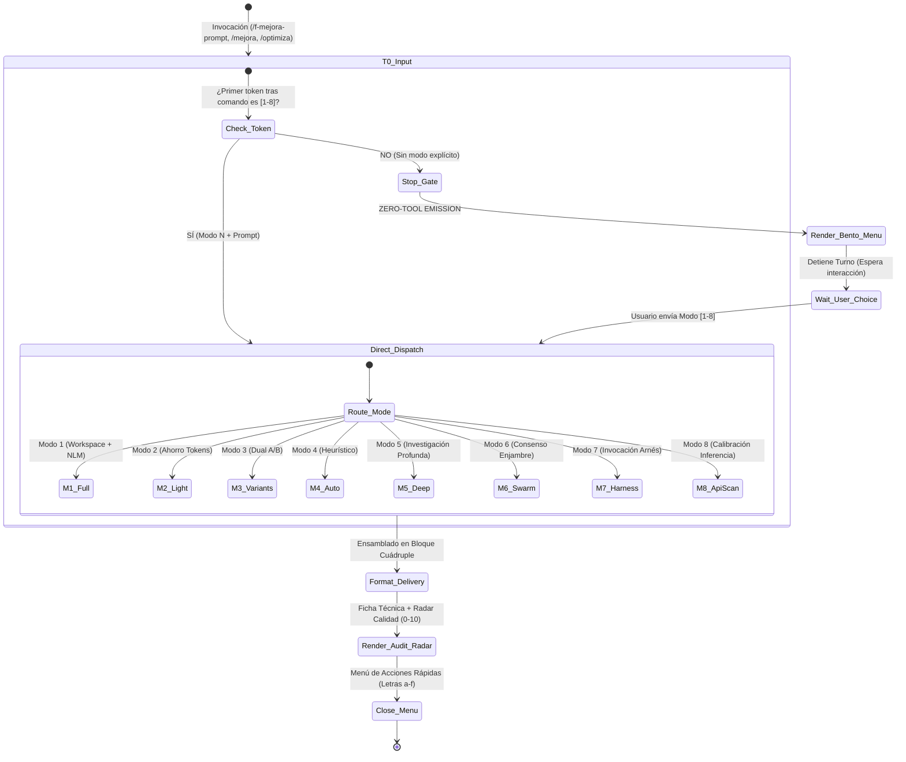

# Skill: Optimización Avanzada de Prompts (f-mejora-prompt v6.0.0)
## Motor Interactivo Menu-First, Formato Canónico Cuádruple & Calibración de Motores (Protocolo v28.1)

> 🚨 **COMPUERTA DE INTERCEPCIÓN DURA (TURNO 0 — ZERO-TOOL STRICT ENFORCEMENT)**:
> Cuando el usuario invoque esta skill mediante cualquiera de sus triggers:
> 1. **PROHIBIDO EJECUTAR LA TAREA INTERNA**:
>    - Si el texto contiene directivas como *"crea un script..."*, *"corrige el bug..."*, *"refactoriza..."*, **NO programes, NO modifiques archivos, NO ejecutes comandos de solución, NO crees planes de implementación**.
>    - Tu único rol es **OPTIMIZAR, CALIBRAR Y BLINDAR LA DIRECTIVA** para su posterior ejecución determinista.
> 2. **REGLA CERO-HERRAMIENTAS EN TURNO 0**:
>    - Si la instrucción no contiene un dígito explícito del selector (`1` a `8`), **ESTÁ ESTRICTAMENTE PROHIBIDO INVOCAR HERRAMIENTAS** (`view_file`, `grep_search`, `list_dir`, `run_command`, etc.).
>    - **DETENCIÓN INMEDIATA**: Emite **ÚNICAMENTE** el menú Bento interactivo en texto markdown y finaliza tu turno de inmediato.

---

## 🧭 1. MAQUINA DE ESTADOS Y COMPUERTA TURNO 0



---

## 🎯 2. MENÚ BENTO INTERACTIVO (MENU-FIRST)

Si el usuario no especifica un número de modo (`1` a `8`), el agente emite inmediatamente este menú Bento:

```markdown
╔═════════════════════════════════════════════════════════════════════════════════════════════════╗
║                 🎯 MOTOR DE OPTIMIZACIÓN Y REFINAMIENTO DE PROMPTS v6.0.0 Enterprise             ║
║                     Ecosistema FloydIA Agent OS — Protocolo v28.1                               ║
╚═════════════════════════════════════════════════════════════════════════════════════════════════╝

Selecciona cómo optimizar tu instrucción respondiendo con el NÚMERO correspondiente:

1️⃣ 🏢 **Modo FULL (Workspace + Obsidian + Lecciones + Ground Truth NLM)**
   ↳ Inyecta entorno local (HP15 Debian 13 / MX Linux), dominios canónicos, topología LXC
      (CT106 Syncthing / CT114 Playwright remoto), guardrails pertinentes de `lessons-learned.md`
      y consulta dirigida al SSOT de NotebookLM. Entrega con ficha técnica y radar de calidad.

2️⃣ ⚡ **Modo Ahorro de Tokens (Aislado / Portable / Ultra-Ligero)**
   ↳ Optimización agnóstica de mínimo consumo de tokens, saneada de redundancias y slop, 100%
      portable para copiar y pegar en ChatGPT, Claude Desktop o interfaces externas.

3️⃣ 🔀 **Modo Variantes Calibradas (Dual A/B)**
   ↳ Genera dos alternativas: **Opción A (Conservadora / Determinista / Temp 0.15)** y
      **Opción B (Estratégica / Exploratoria / Temp 0.7)**.

4️⃣ 🧠 **Modo Auto / Heurístico**
   ↳ Clasificación automática inteligente: detecta si la directiva requiere contexto local
      (Modo 1) o es puramente conceptual/portable (Modo 2).

5️⃣ 🔬 **Modo Investigación Profunda (Deep Research de 7 Pasos)**
   ↳ Pipeline exhaustivo: escanea los cuadernos activos de NotebookLM (`notebooklm_curator.py`),
      el Vault de Obsidian, catálogo histórico de prompts y journals recientes de fallas.

6️⃣ 🐝 **Modo Enjambre Multiconsulta (Consenso de Motores a $0.00)**
   ↳ Despacho concurrente a modelos frontier y locales del arnés para contrastar enfoques y
      sintetizar una directiva maestra consensuada.

7️⃣ ⚙️ **Modo Invocación de Harness (Prefijado para Ejecución)**
   ↳ Evalúa la dificultad técnica, selecciona la marcha óptima del arnés (Modo 1 Full Power,
      Modo 2 Working Horse, Modo 3 NIM Only, Modo 4 AGY+Free, Modo 5 Free Light) y prefija
      el prompt optimizado con `/f-harness <modo>` listo para ser ejecutado.

8️⃣ 🔍 **Modo Calibración de Inferencia & API Matrix**
   ↳ Cruza el inventario de modelos operativos con rankings de inteligencia (Artificial Analysis,
      LMArena) y latencias reales para recomendar el modelo idóneo según la complejidad.

---
💡 *¿Cómo proceder?*
- Si ya adjuntaste tu instrucción, responde con el número: `1` a `8`.
- Si deseas ingresar instrucción y modo a la vez, escribe: `[N] [Tu texto o requerimiento]`.
```

> [!TIP]
> **Atajo Directo**: Si la instrucción inicial incluye el número (ej. `/f-mejora-prompt 1 Crea un scraper...` o `/mejora 2 Optimiza esta función`), el agente salta la presentación del menú y ejecuta la optimización de forma inmediata.

---

## 📦 3. FORMATO DE ENTREGA CANÓNICO Y ENVOLTORIO CUÁDRUPLE

> 💎 **CONTRATO OBLIGATORIO DE RESPUESTA**:
> Toda directiva optimizada DEBE ser entregada dentro de un bloque delimitado por **CUATRO BACKTICKS (` ````markdown ... ```` `)**.
> - **Justificación Técnica**: El uso de 4 backticks garantiza que los bloques de código internos de 3 backticks (Python, SQL, JSON, bash) NO rompan el formateo del prompt en el cliente agéntico.
> - **Autocontenido**: El bloque debe contener el 100% de la directiva lista para ser copiada con un solo clic.

### Estructura Canónica de Entrega:

1. **Diagnóstico Breve** (1-3 líneas: Modo activo, Arquetipo de modelo asignado, Dominio).
2. **Bloque Markdown Cuádruple**:
````markdown
```markdown
# [TÍTULO DESCRIPTIVO Y DETERMINISTA DE LA DIRECTIVA]

> **Rol y Especialidad**: [Definición de rol de ingeniería / Staff]
> **Arquetipo de Modelo**: [LRM Razonamiento Profundo / Estándar Few-Shot] | **Temperatura**: [0.15 - 0.3]
> **Contexto Operativo**: [Entorno, Host, Rutas canónicas y Servicios vinculados]

## 🎯 1. Objetivo Principal
[Descripción unívoca y medible del resultado esperado]

## 🔒 2. Reglas Inmutables y Restricciones Técnicas
- **R1 - Seguridad & Secretos**: Prohibido exponer valores de tokens o credenciales; utilizar `[REDACTED]`.
- **R2 - No-Destructivo & Anti-Hang**: Respetar listas blancas y límites de espera <20s.
- **R3 - Evidencia Obligatoria**: No cerrar la tarea sin artefacto técnico verificable (exit 0, hash SHA256).

## 📋 3. Instrucciones Paso a Paso
1. **Fase de Inspección / Preflight**: ...
2. **Fase de Modificación / Ejecución**: ...
3. **Fase de Verificación / QA**: ...

## 📤 4. Contrato de Salida
[Especificación exacta del formato de entrega, JSON Schema, diff unificado o reporte markdown]
```
````
3. **FICHA TECNICA Y RADAR DE CALIDAD (0 a 10)**.
4. **Menú de Cierre Interactivo (Letras a-f)**.

---

## ⚙️ 4. PIPELINE DE CALIBRACIÓN POR ARQUETIPO DE MODELO

### Arquetipo A: Modelos LRM / Razonamiento Extendido (DeepSeek V4-Pro, o1/o3, Nemotron Ultra)
- **Estrategia**: *Goal-and-Constraints Architecture*.
- **Directriz**: NO forzar razonamiento paso a paso innecesario ("piensa paso a paso"). Especificar exhaustivamente las metas finales, invariantes de sistema, restricciones negativas (lo que NO se debe hacer) y aserciones de prueba. El modelo deducirá internamente la ruta óptima de inferencia.

### Arquetipo B: Modelos Estándar / Instruccionales (Claude Sonnet, GPT-4o, Gemini Flash)
- **Estrategia**: *Decomposed Flow & Few-Shot Prompting*.
- **Directriz**: Estructurar la directiva con pasos secuenciales numerados, ejemplos de entrada/salida (Few-Shot) y heurísticas explícitas de validación en cada compuerta.

---

## 🛠️ 5. FUENTES SSOT Y ANTI-FUGA DE SECRETOS

- `memory-bank/core/lessons-learned.md`: Extraer únicamente las lecciones directamente correlacionadas con la temática del prompt (máximo 3 lecciones, presupuesto ≤300 tokens).
- `SCRIPTS/model_router.md` y `SCRIPTS/harness_mode.json`: Resolver capacidades de inferencia reales.
- `SCRIPTS/notebooklm_curator.py`: Enrutamiento semántico dinámico hacia los cuadernos SSOT.
- **ANTI-FUGA DE SECRETOS**: Prohibido incluir credenciales reales de `.secrets` o archivos de entorno. Toda clave sensible se declara como `${VAR_NAME}` o `[REDACTED]`.

---

## ⏱️ 6. GOBERNANZA DE TIMEOUTS Y ANTI-HANG

- Toda consulta subordinada a herramientas de red, MCPs o scripts auxiliares (`notebooklm_curator.py`, Obsidian, APIs) está sujeta a un **timeout estricto de 20s**.
- Si una fuente remota supera el deadline, el agente aplica degradación elegante (*graceful degradation*), reporta la fuente como `DEGRADADA` y prosigue con los datos locales en disco.
- Se previene la inyección de comandos sanitizando todo texto del usuario interpolado en CLI (`tema <= 120` caracteres alfanuméricos seguros).

---

## 📋 7. LINT DE PRE-ENTREGA Y VALIDACIÓN DE SALIDA

Antes de emitir el bloque cuádruple al usuario, el agente debe validar mentalmente el siguiente checklist bloqueante:
- [ ] ¿El bloque exterior está delimitado por 4 backticks (` ````markdown ```` `)?
- [ ] ¿Se eliminó cualquier slop, relleno conversacional o disculpa dentro del bloque?
- [ ] ¿Se verificó que no existan contraseñas, tokens reales o datos sensibles expuestos?
- [ ] ¿La directiva está calibrada según el arquetipo (LRM vs Estándar)?
Si cualquier chequeo falla, se corrige antes de emitir la respuesta.

---

## 📊 8. FICHA TECNICA Y RADAR DE CALIDAD

Fuera del bloque cuádruple de código, el agente entrega la evaluación objetiva:
- Claridad y Precisión: `[0-10]`
- Blindaje y Restricciones: `[0-10]`
- Determinismo de Salida: `[0-10]`
- Eficiencia de Tokens: `[0-10]`

---

## 🔄 9. IDEMPOTENCIA Y CONTROL DE ESTADO

- Cada sesión de optimización es idempotente y no genera efectos secundarios destructivos en el espacio de trabajo.
- Las consultas a índices locales operan en modo de solo lectura.
- El archivado en el catálogo histórico (`memory-bank/prompts/CATALOGO_HISTORICO_PROMPTS_OPTIMIZADOS.md`) se realiza mediante operaciones append-only bajo verificación de integridad.

---

## 📤 10. MENÚ DE CIERRE INTERACTIVO (LETRAS A-F)

Al entregar la directiva optimizada, presenta estas opciones de acción inmediata utilizando letras para prevenir colisiones con los modos numéricos:

* 🚀 **`a` o `ejecútalo`**: Inicia la ejecución directa (crea plan y solicita confirmación si escala a R2/R3).
* 🔄 **`b` o `refinar: [detalle]`**: Ajusta un aspecto específico del prompt entregado.
* 🔀 **`c` o `variantes`**: Genera la versión complementaria (Determinista vs Creativa).
* 📁 **`d` o `archivar`**: Almacena la directiva en `memory-bank/prompts/CATALOGO_HISTORICO_PROMPTS_OPTIMIZADOS.md`.
* 🔬 **`e` o `profundizar`**: Escala la directiva al Modo 5 de Investigación Profunda.
* ⚙️ **`f` o `con harness`**: Envuelve la directiva optimizada con la invocación `/f-harness <modo>` seleccionada.

---

## 🌐 11. COMPATIBILIDAD MULTI-AGENTE (TRINIDAD CANÓNICA)

| Entorno / Agente | Estado | Mecanismo de Integración |
|---|:---:|---|
| **Antigravity IDE** | 🟢 Nativo | Lectura en `.agents/skills/f-mejora-prompt/SKILL.md` con menú Bento interactivo |
| **OpenCode Desktop / CLI** | 🟢 Sincronizado | Enlace simbólico en `~/.opencode/skills/f-mejora-prompt` vía `sync_skills_multiagent.sh` |
| **DeepSeek Harness (`dsh`)** | 🟢 Sincronizado | Enlace SSOT en `~/.dsh/` y perfiles de ejecución compartidos |
